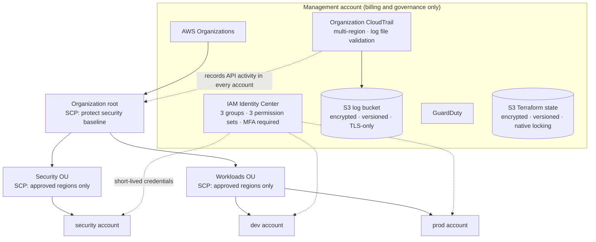
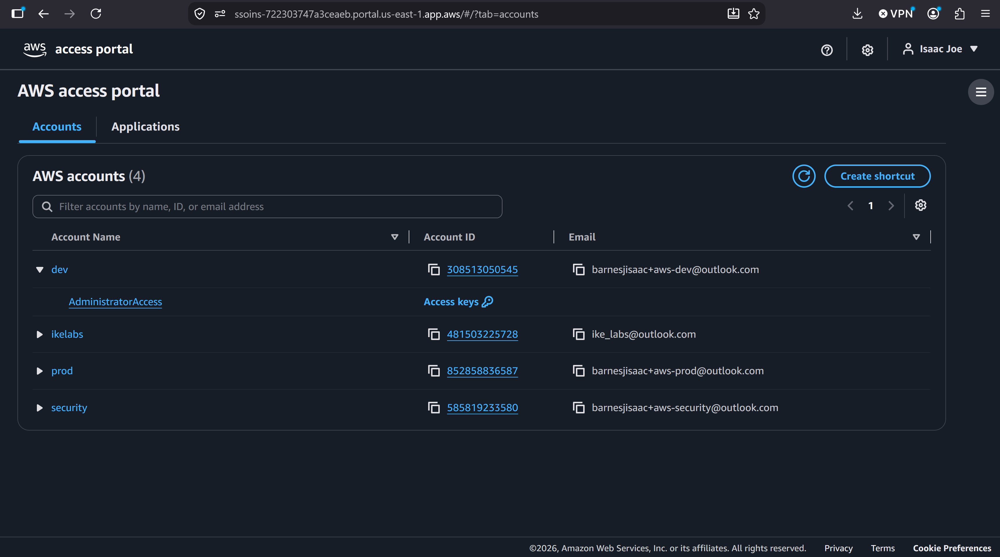
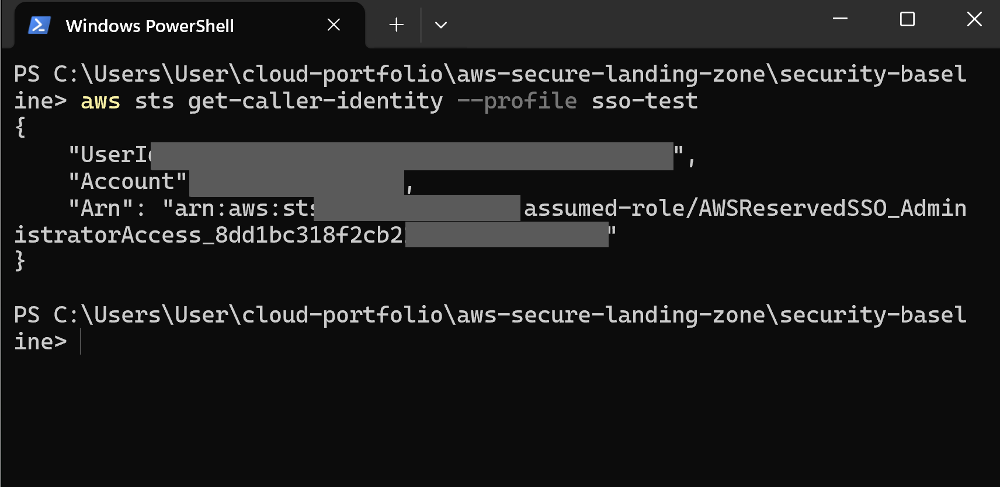
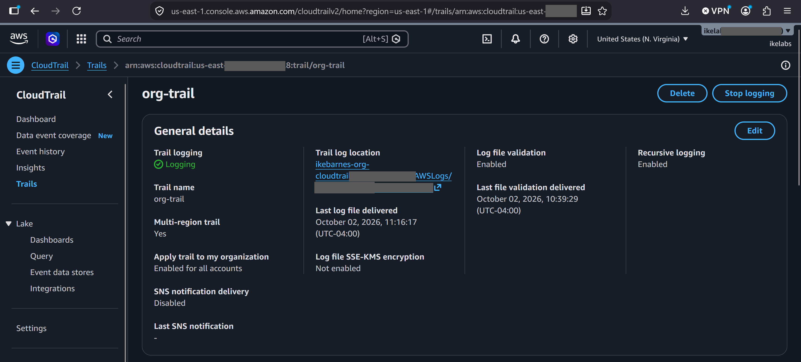
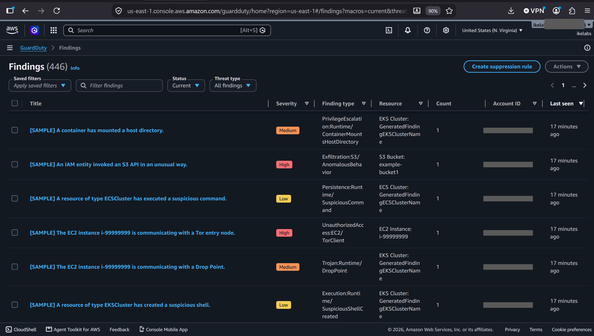
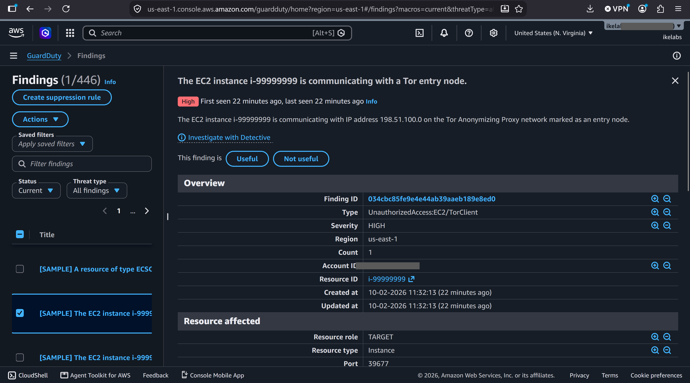

# AWS Secure Landing Zone (Terraform)

A secure, multi-account AWS foundation built entirely with Terraform: AWS Organizations with service control policy guardrails, IAM Identity Center (SSO) with group-based least-privilege access, organization-wide CloudTrail, and GuardDuty threat detection. No long-lived access keys exist anywhere in the environment.

This is the base layer every serious AWS environment needs before any workload is deployed, and the first project in my cloud engineering portfolio.

**Skills shown:** AWS Organizations · Service control policies · IAM Identity Center (SSO) · CloudTrail · GuardDuty · Terraform (remote state, `for_each`, lifecycle rules) · Least-privilege IAM design · Security and compliance (NIST, FISMA, HIPAA concepts)

---

## Architecture



---

## What's built

| Component | What it does | Code |
|---|---|---|
| State bootstrap | S3 bucket for Terraform state: versioned, encrypted, public access blocked, HTTPS-only | [`bootstrap/`](bootstrap/) |
| Organization | Management account plus security, dev, and prod accounts in two OUs | [`organization/main.tf`](organization/main.tf) |
| Guardrails | SCPs that restrict regions, block CloudTrail tampering, and block leaving the org | [`organization/scps.tf`](organization/scps.tf) |
| SSO | IAM Identity Center groups, permission sets, and account assignments | [`security-baseline/identity-center.tf`](security-baseline/identity-center.tf) |
| Audit logging | Organization-wide, multi-region CloudTrail with log file validation | [`security-baseline/cloudtrail.tf`](security-baseline/cloudtrail.tf) |
| Threat detection | GuardDuty continuous monitoring | [`security-baseline/guardduty.tf`](security-baseline/guardduty.tf) |

---

## Access model

Permissions are granted only to groups, never to individual users. This table is the entire access policy for the organization, defined in code:

| Group | Management | Security | Dev | Prod |
|---|---|---|---|---|
| **Admins** | AdministratorAccess | AdministratorAccess | AdministratorAccess | AdministratorAccess |
| **Developers** | none | none | PowerUserAccess | ReadOnlyAccess |
| **Auditors** | ReadOnlyAccess | ReadOnlyAccess | ReadOnlyAccess | ReadOnlyAccess |

- MFA is required at every sign-in.
- Admin sessions expire after 4 hours; other sessions after 8.
- Terraform itself runs through an SSO session. The temporary IAM user used for the first deployment was deleted once SSO was working.

---

## Guardrails: tested, not assumed

SCPs were tested from the prod account while signed in as an **administrator**, to prove that even admins can't get around them.

| Test | Expected | Result | Evidence |
|---|---|---|---|
| Sign in to the prod account | Allowed | ✅ Allowed | [01](docs/screenshots/01-access-prod-account.png) |
| List VPCs in us-east-1 (approved region) | Allowed | ✅ Allowed | [02](docs/screenshots/02-allowed-region-works.png) |
| List VPCs in eu-west-1 (unapproved region) | Denied by SCP | ✅ Denied | [03](docs/screenshots/03-blocked-region-denied.png) |
| Stop CloudTrail logging | Denied by SCP | ✅ Denied | [04](docs/screenshots/04-cloudtrail-protected.png) |
| Leave the organization | Denied by SCP | ✅ Denied | [05](docs/screenshots/05-leave-org-denied.png) |

Every denial reports an *explicit deny in a service control policy*, which confirms the SCP did the blocking.

---

## Screenshots

**SSO access portal:** one sign-in, four accounts



**CLI signed in through SSO,** with no access keys



**Terraform running through SSO,** with no changes after replacing the access keys


**Organization CloudTrail:** applied to all accounts, multi-region, log file validation enabled



**GuardDuty findings** (generated sample findings, used to verify detection)



**GuardDuty finding detail:** high-severity Tor communication (sample)



---

## Repository structure

```
aws-secure-landing-zone/
├── bootstrap/            # S3 state bucket (local state, run once)
├── organization/         # Organization, OUs, accounts, SCPs
├── security-baseline/    # IAM Identity Center, CloudTrail, GuardDuty
└── docs/
    ├── decisions.md      # Why it's built this way, and the trade-offs
    └── screenshots/      # Evidence for every test above
```

---

## How to deploy

**Prerequisites:** an AWS account with root MFA enabled, Terraform 1.10 or later, and AWS CLI v2.

1. **State bucket** (run once, with temporary admin credentials):
   ```
   cd bootstrap
   terraform init
   terraform apply
   ```
   Copy the bucket name into the `backend` block of `organization/versions.tf` and `security-baseline/versions.tf`.

2. **Organization and guardrails:**
   ```
   cd organization
   cp terraform.tfvars.example terraform.tfvars   # add a unique email per account
   terraform init
   terraform apply
   ```

3. **Enable IAM Identity Center** once in the console (us-east-1, organization instance). This is the one step AWS requires by hand.

4. **SSO, logging, and threat detection:**
   ```
   cd security-baseline
   cp terraform.tfvars.example terraform.tfvars
   terraform init
   terraform apply
   ```

5. **Switch the CLI to SSO,** then delete the temporary admin user and its access keys.

---

## Design decisions

Every significant choice and its trade-off is documented in **[docs/decisions.md](docs/decisions.md)**. Highlights:

- **S3 native state locking** instead of a DynamoDB table (Terraform 1.10+).
- **Deny-list SCPs** with global services exempted from the region rule.
- **Single-Region Identity Center** to keep lab costs at zero; multi-Region in production.
- **Security Hub deferred** until AWS Config is enabled, since its checks depend on Config.

---

## Cost

Built to run at close to zero cost:

- The accounts, OUs, SCPs, and IAM Identity Center are free.
- The first copy of CloudTrail management events is free; S3 log storage costs cents per month.
- GuardDuty is free for 30 days, then typically a few dollars a month for a low-activity environment.
- A $20 monthly budget alert is in place.

---

## Challenges and how I solved them

- **Account quota on a new organization.** New organizations start with a very low account limit, so the first apply created only the prod account before failing. I requested an increase through Service Quotas and tested the guardrails on prod in the meantime. Once approved, a second apply created only the missing accounts.
- **SSO login failing with "Invalid start URL."** The CLI config still held a placeholder portal address. Newer Identity Center instances use a different URL format than most tutorials show. I corrected the config, cleared the cached login, and the SSO login worked.
- **Empty account ID in a CLI profile.** A role ARN in an error message was missing its account number, which pointed straight to the cause: the profile had been built from a Terraform output that didn't exist yet after a partial apply.

---

## Next steps

- Make the security account the delegated administrator for GuardDuty and Security Hub.
- Move CloudTrail logs to a dedicated log archive account with S3 Object Lock.
- Enable AWS Config with the NIST 800-171 conformance pack, and Security Hub.

---

## Author

**Isaac Barnes**, Cloud Engineer · AWS Certified Solutions Architect – Associate · CompTIA Security+

[LinkedIn](https://linkedin.com/in/ike-barnes) · [GitHub](https://github.com/ikebarnes)
